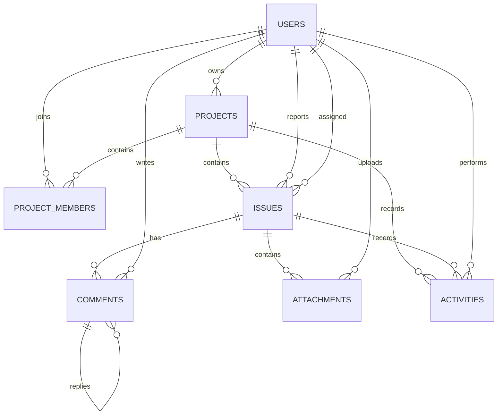

# Bug Tracker Database Schema

## 1. Overview

The application uses PostgreSQL with SQLAlchemy ORM.

Primary keys use UUID values. Tables use foreign keys to maintain relational integrity.

## 2. Database Tables

### users

Stores registered users.

| Column | Type | Description |
|---|---|---|
| id | UUID | Primary key |
| full_name | VARCHAR | User's full name |
| email | VARCHAR | Unique email |
| hashed_password | VARCHAR | Hashed password |
| role | ENUM | ADMIN, DEVELOPER, VIEWER |
| is_active | BOOLEAN | Account status |
| is_verified | BOOLEAN | Verification status |
| created_at | TIMESTAMP | Creation date |
| updated_at | TIMESTAMP | Last update |

### projects

Stores project information.

| Column | Type | Description |
|---|---|---|
| id | UUID | Primary key |
| name | VARCHAR | Project name |
| key | VARCHAR | Unique project key |
| description | TEXT | Project description |
| status | ENUM | Project status |
| owner_id | UUID | FK → users.id |
| created_at | TIMESTAMP | Creation date |
| updated_at | TIMESTAMP | Last update |

### project_members

Connects users to projects.

| Column | Type | Description |
|---|---|---|
| id | UUID | Primary key |
| project_id | UUID | FK → projects.id |
| user_id | UUID | FK → users.id |
| role | ENUM | Project member role |
| joined_at | TIMESTAMP | Membership date |

A user should not have duplicate membership records for the same project.

### issues

Stores bugs, tasks, and feature requests.

| Column | Type | Description |
|---|---|---|
| id | UUID | Primary key |
| issue_key | VARCHAR | Human-readable issue identifier |
| title | VARCHAR | Issue title |
| description | TEXT | Issue details |
| type | ENUM | BUG, TASK, FEATURE |
| status | ENUM | TODO, IN_PROGRESS, IN_REVIEW, DONE |
| priority | ENUM | LOW, MEDIUM, HIGH, CRITICAL |
| project_id | UUID | FK → projects.id |
| reporter_id | UUID | FK → users.id |
| assignee_id | UUID | FK → users.id, nullable |
| story_points | INTEGER | Estimated effort |
| labels | JSON/JSONB | Issue labels |
| due_date | DATE | Optional deadline |
| created_at | TIMESTAMP | Creation date |
| updated_at | TIMESTAMP | Last update |

### comments

Stores issue comments and threaded replies.

| Column | Type | Description |
|---|---|---|
| id | UUID | Primary key |
| issue_id | UUID | FK → issues.id |
| user_id | UUID | FK → users.id |
| parent_id | UUID | FK → comments.id, nullable |
| content | TEXT | Comment content |
| created_at | TIMESTAMP | Creation date |
| updated_at | TIMESTAMP | Last update |

### attachments

Stores uploaded file metadata.

| Column | Type | Description |
|---|---|---|
| id | UUID | Primary key |
| issue_id | UUID | FK → issues.id |
| uploaded_by | UUID | FK → users.id |
| original_filename | VARCHAR | Original file name |
| stored_filename | VARCHAR | Safe stored name |
| storage_path | VARCHAR | Internal storage location |
| content_type | VARCHAR | MIME type |
| file_size | BIGINT | File size in bytes |
| uploaded_at | TIMESTAMP | Upload date |

Files are stored separately from PostgreSQL. The database stores their metadata and storage location.

### activities

Stores issue and project activity history.

| Column | Type | Description |
|---|---|---|
| id | UUID | Primary key |
| project_id | UUID | FK → projects.id |
| issue_id | UUID | FK → issues.id, nullable |
| actor_id | UUID | FK → users.id |
| action | VARCHAR | Activity type |
| description | TEXT | Human-readable description |
| extra_data | JSON/JSONB | Additional details |
| created_at | TIMESTAMP | Activity date |

## 3. Entity Relationships

- One user can own many projects.
- Users and projects have a many-to-many relationship through project_members.
- One project can contain many issues.
- One user can report many issues.
- One user can be assigned many issues.
- One issue can contain many comments.
- Comments can have nested replies.
- One issue can contain many attachments.
- One issue or project can have many activity records.

## 4. Relationship Diagram

## 5. Database Integrity

- Email addresses must be unique.
- Project keys must be unique.
- Project membership should be unique per project and user.
- Issue references must point to valid projects and users.
- Replies must reference comments belonging to the same issue.
- Deletion behavior must respect foreign-key constraints.
- Passwords must never be stored in plain text.

**Implementation note:** Verify enum names, JSON column types, constraints, and deletion behavior against the actual SQLAlchemy models and Alembic migrations.
